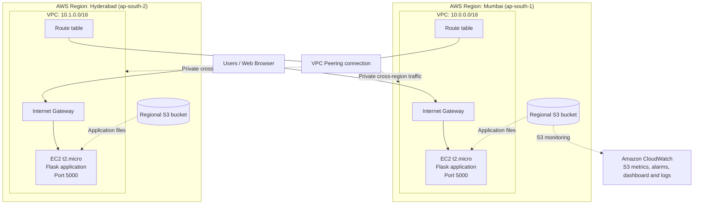
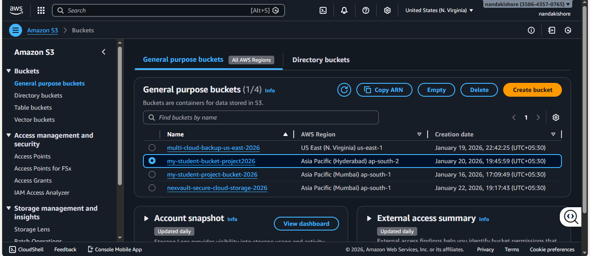
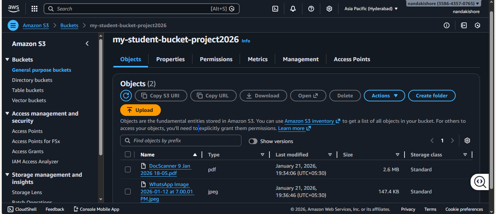
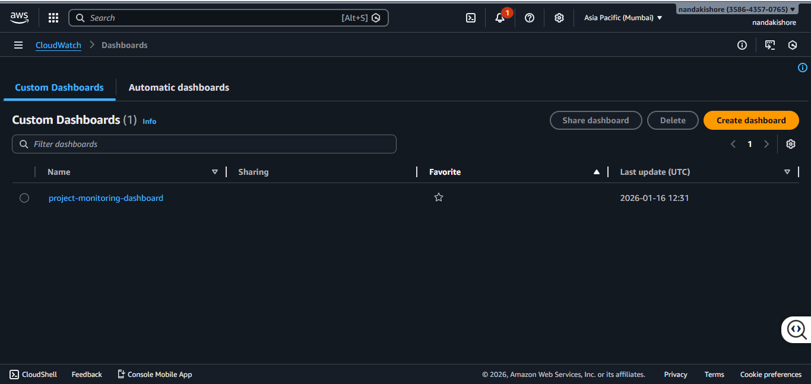
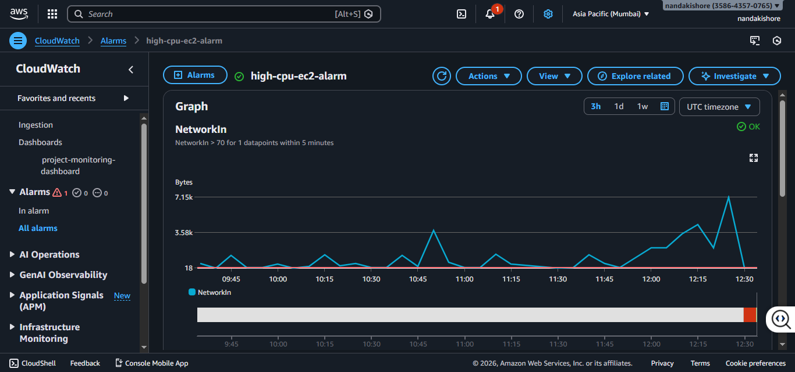

# AWS Multi-Region Architecture and Security Implementation

A hands-on AWS learning project documenting a multi-region cloud setup across **Asia Pacific (Mumbai) `ap-south-1`** and **Asia Pacific (Hyderabad) `ap-south-2`**. The project brings together cloud storage, compute, networking, access control, security configurations, application deployment, and monitoring.

> **Project status:** Completed as a learning project. The AWS Free Tier account used for the implementation is no longer active, so the infrastructure is not currently deployed. This repository preserves project documentation and screenshots; it is not a live service.

## Project objectives

- Configure Amazon S3 storage and security controls.
- Work with EC2 instances in two AWS regions.
- Connect regional VPCs using VPC Peering.
- Deploy the same Flask application in both regions.
- Configure IAM groups and S3 permissions.
- Monitor S3 activity and storage metrics with CloudWatch.
- Explore regional deployment, monitoring, and security practices.

## AWS services used

| Service | Role in the project |
|---|---|
| **Amazon S3** | Object storage for application files and demo data, bucket versioning, encryption, public-access controls, and bucket policies. |
| **Amazon EC2** | Virtual machines hosting the Flask application in Mumbai and Hyderabad. |
| **Amazon VPC** | Separate virtual networks for the two regions. |
| **VPC Peering** | Private connectivity between the regional VPCs, with route-table entries. |
| **AWS IAM** | Groups and policies for S3 access control. |
| **Amazon CloudWatch** | S3 metrics, dashboard visualizations, alarms, and monitoring. |
| **AWS SNS** | Email/alert notifications for the documented CloudWatch alarms. |

## Regional architecture

The architecture and deployment reports describe the following setup:

| Component | Mumbai | Hyderabad |
|---|---|---|
| Region | `ap-south-1` | `ap-south-2` |
| VPC CIDR | `10.0.0.0/16` | `10.1.0.0/16` |
| Subnet | `10.0.1.0/24` | `10.1.1.0/24` |
| EC2 instance type | `t2.micro` | `t2.micro` |
| Operating system | Amazon Linux (the reports differ on version; see notes below) | Amazon Linux (the reports differ on version; see notes below) |
| Regional S3 bucket named in the architecture section | `asia-pacific-mumbai-bucket` | `asia-pacific-hyderabad-bucket` |

The reports describe VPC Peering between the two VPCs, route-table configuration for inter-region traffic, and security-group rules for SSH (port 22), HTTP (port 80), and the Flask application (port 5000).

## Architecture diagram

The following diagram summarizes the two-region architecture described in the project reports. It is a documentation diagram of the historical setup, not a live AWS deployment.



## Flask application

The deployment report describes the same Flask application deployed in both regions:

- **Framework:** Flask (Python)
- **Port:** `5000`
- **Endpoints:** `/`, `/region`, and `/health`
- **Application files in the original deployment report:** `demo-app.py`, `requirements.txt`, and `README.md` stored in the regional S3 buckets.
- **Startup:** The report mentions a systemd service for automatic startup; its listed deployment steps also show starting the app with `python3 demo-app.py`.

### Recreated Flask sample in this repository

The `app.py` file is a simple, recreated example based on the three endpoints described in the project report. It is provided as a learning sample and is **not claimed to be the exact original `demo-app.py` source code** used during the AWS implementation.

The application provides:

- `/` — welcome message and current region.
- `/region` — region information.
- `/health` — basic health status.

### Run the application on your computer

1. Install Python 3.
2. Open a terminal in the repository folder.
3. (Optional) Create and activate a virtual environment.
4. Install the required package:

   ```bash
   pip install -r requirements.txt
   ```

5. Start the application. On Windows PowerShell, set the region and run:

   ```powershell
   $env:AWS_REGION_NAME="Mumbai"
   python app.py
   ```

   To simulate the Hyderabad instance instead:

   ```powershell
   $env:AWS_REGION_NAME="Hyderabad"
   python app.py
   ```

   On Linux, use `export AWS_REGION_NAME="Mumbai"` (or `"Hyderabad"`) before running `python3 app.py`.

6. Open these addresses in your browser:

   - `http://127.0.0.1:5000/`
   - `http://127.0.0.1:5000/region`
   - `http://127.0.0.1:5000/health`

The default region is Mumbai if no environment variable is set. The app listens on port 5000 and on all network interfaces so it can run on a server. If you deploy it on EC2, allow inbound port 5000 only from the specific trusted IP addresses or network ranges needed for your test; do not expose it to everyone unnecessarily.

### Deployment process documented in the report

The following steps are listed for both Mumbai and Hyderabad EC2 instances:

1. Connect to the EC2 instance using **EC2 Instance Connect**.
2. Update the system packages:
   ```bash
   sudo yum update -y
   ```
3. Install Python 3 and pip:
   ```bash
   sudo yum install python3 python3-pip -y
   ```
4. Install Flask:
   ```bash
   sudo pip3 install flask
   ```
5. Download `demo-app.py` from the S3 bucket in that region.
6. Start the Flask application:
   ```bash
   python3 demo-app.py
   ```
7. Verify the application using `http://<public-ip>:5000`.

The application provides region-specific information and a health-check endpoint. The reports describe private cross-region communication through VPC Peering and the ability to redirect traffic to the other region if one instance becomes unavailable. They also mention Route 53 as a possible way to implement traffic redirection; this README does not claim that Route 53 was configured.

## VPC Peering and network configuration

The deployment report documents:

- A peering connection named `mumbai-hyderabad-peering`.
- Mumbai VPC CIDR: `10.0.0.0/16`.
- Hyderabad VPC CIDR: `10.1.0.0/16`.
- A route in the Mumbai VPC for `10.1.0.0/16` targeting the peering connection.
- A route in the Hyderabad VPC for `10.0.0.0/16` targeting the peering connection.
- Default routes (`0.0.0.0/0`) to the respective Internet Gateways.
- Security-group access for SSH, HTTP, and the Flask application as described in the reports.

## Amazon S3 security implementation

The Cloud Security Implementation Report documents three secured buckets:

| Bucket | Region | Server-side encryption | Versioning |
|---|---|---|---|
| `nexvault-secure-cloud-storage-2026` | Mumbai (`ap-south-1`) | SSE-KMS | Enabled |
| `my-student-project-bucket-2026` | Mumbai (`ap-south-1`) | SSE-S3 | Enabled |
| `my-student-bucket-project2026` | Hyderabad (`ap-south-2`) | SSE-S3 | Standard, as stated in the report |

The security report describes these controls:

- **Block Public Access:** Enabled on all three security-focused buckets.
- **Encryption at rest:** SSE-KMS or SSE-S3, depending on the bucket.
- **HTTPS-only access:** A bucket policy named `DenyInsecureTransport` denies S3 requests when `aws:SecureTransport` is `false`.

The deployment report separately describes the two regional demo buckets as having public read-only access to demo files. This differs from the security report's blocked-public-access configuration. These are retained as separate configurations from the source documents and should not be interpreted as one uniform policy applied to every bucket.

The architecture report also identifies `my-student-project-bucket-2026` as the bucket used for its S3 and CloudWatch monitoring example. Bucket names are kept in their original report contexts rather than treated as one combined inventory.

## IAM access groups

The security report documents two IAM groups:

| Group | Attached policy | Intended purpose |
|---|---|---|
| `S3-Secure-Access-Group` | `AmazonS3FullAccess` | Full S3 access for administrative operations |
| `S3-ReadOnly-Audit-Group` | `AmazonS3ReadOnlyAccess` | Read-only access for audit and review |

**Important:** The report records zero users assigned to each group at the time it was written. The groups and attached policies are documented as configured; this README does not claim that users were assigned to them.

## CloudWatch monitoring and alarms

The architecture report describes monitoring for `my-student-project-bucket-2026`.

### Metrics

- `NumberOfObjects` — daily storage metric.
- `BucketSizeBytes` — daily storage metric.
- `AllRequests`, `4xxErrors`, and `5xxErrors` — request metrics at one-minute granularity.

### Alarms documented

| Alarm | Reported condition | Reported action |
|---|---|---|
| High Error Rate | 4xx and 5xx errors greater than 5% of requests | SNS email notification |
| Bucket Size Threshold | Bucket size greater than 500 MB | SNS alert |
| Object Count Change | Change greater than 50 objects | CloudWatch log entry |

### Dashboard and logs

- Dashboard: `S3-Bucket-Monitoring-Dashboard`
- Refresh rate: 1 minute
- Widgets: bucket-size line chart, object-count gauge, request-rate area chart, and stacked error-rate chart.
- The report lists the log group `/aws/s3/my-student-project-bucket-2026` and a 30-day retention period.

## Screenshots

Screenshots from the original AWS work are organized by service.

### S3 storage and regions







### Networking and access control


### CloudWatch monitoring







## Project documentation

All three project documents are available in the `Documentation` folder:

1. [Cloud Security Implementation Report](Documentation/Cloud-Security-Implementation-Report.pdf)
2. [Final Project Report](Documentation/Final-Project-Report.pdf)
3. [Multi-Region Deployment Process](Documentation/Multi-Region-Deployment-Process.pdf)

## Repository structure

```text
.
├── Documentation/
│   ├── Cloud-Security-Implementation-Report.pdf
│   ├── Final-Project-Report.pdf
│   └── Multi-Region-Deployment-Process.pdf
├── Screenshots/
│   ├── S3/
│   ├── Networking/
│   ├── IAM/
│   └── CloudWatch/
├── app.py
├── requirements.txt
├── README.md
├── LICENSE
└── .gitignore
```

## Key learning outcomes

Through this project, I gained practical experience with:

- Creating and configuring S3 buckets across AWS regions.
- Applying S3 encryption, versioning, public-access restrictions, and bucket policies.
- Launching EC2 instances and deploying a Python Flask application.
- Installing application dependencies and running a web application on an EC2 instance.
- Configuring VPC Peering, route tables, and security-group rules.
- Creating IAM groups and attaching access policies.
- Using CloudWatch metrics, dashboards, and alarms to monitor S3.
- Understanding multi-region application deployment and regional availability concepts.

## Notes on project status and source documents

- The implementation was carried out using the AWS console during the learning project.
- The AWS account used at the time is no longer active; therefore, the deployed resources cannot currently be accessed or verified live.
- This README summarizes the three reports and the screenshots retained in this repository. It describes the historical project, not a currently running deployment.
- The reports contain differences in some details. For example, the deployment report's architecture overview mentions Amazon Linux 2, while its infrastructure details and the other project report mention Amazon Linux 2023. The README avoids asserting one version as definitively used.
- The deployment report describes public read-only access for its regional demo buckets, while the security report documents Block Public Access enabled for its three security buckets. These may refer to separate buckets/configurations; the documents do not fully reconcile them.
- Some S3 bucket names appear in different report sections for the monitoring, regional architecture, and security examples. They have been kept in their original contexts instead of assuming they refer to the same set of buckets.
- The deployment report mentions systemd for automatic startup but lists a direct `python3 demo-app.py` start command. Both details are retained without assuming a systemd unit was definitely configured.
- The `app.py` in this repository is a recreated learning sample based on the documented endpoints, not a verified copy of the original `demo-app.py`.
- Account-specific identifiers have intentionally been omitted from this public README.

## Author

**Nanda Kishore Ulavapati**

- GitHub: [NANDAKISHORE58](https://github.com/NANDAKISHORE58)
