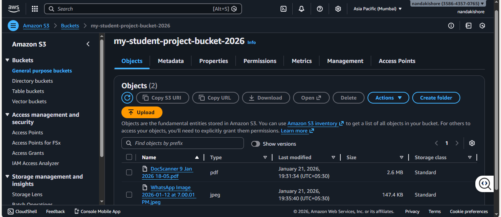
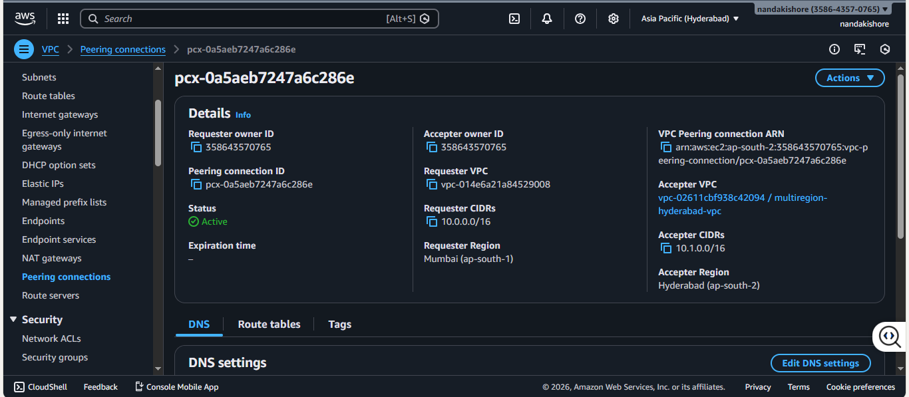
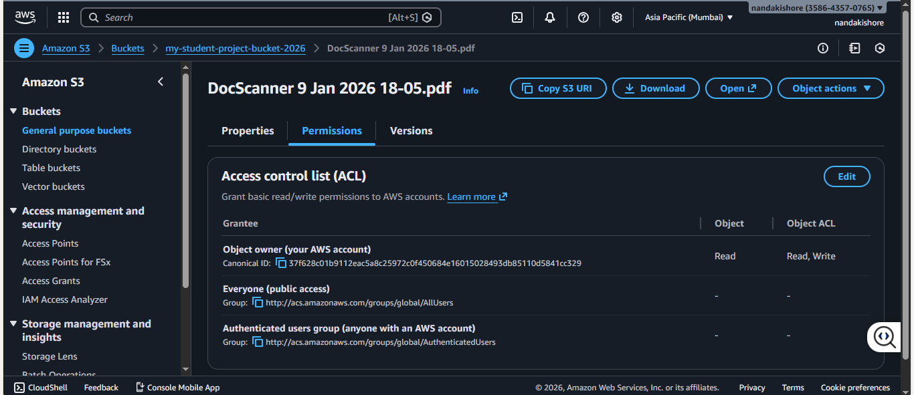
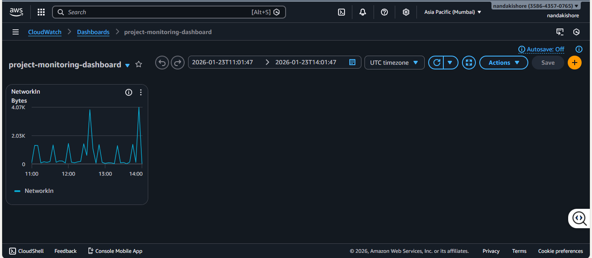
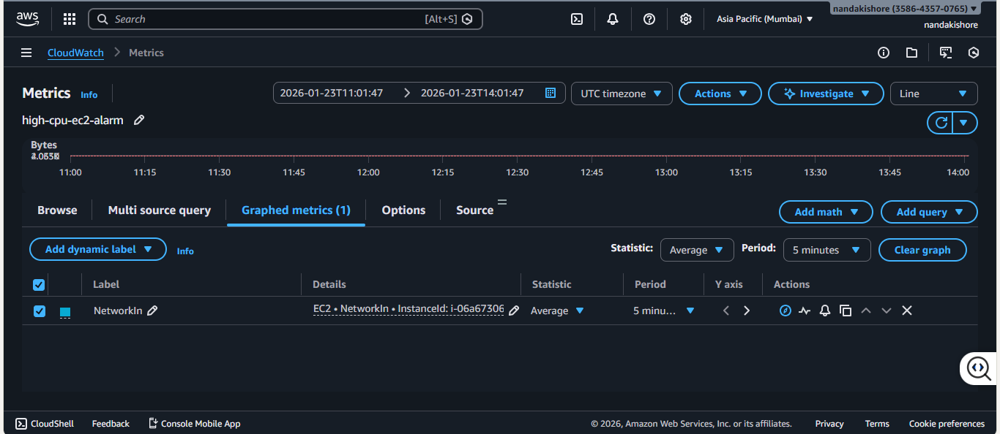
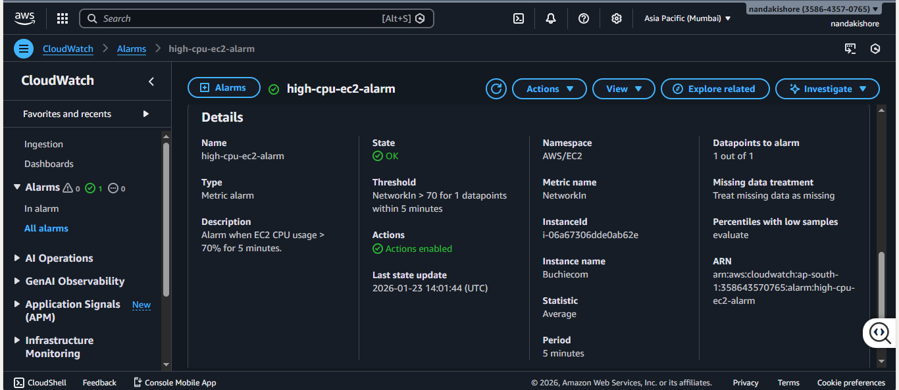

# AWS Multi-Region Architecture and Security Implementation

A hands-on AWS learning project documenting a multi-region cloud setup across **Asia Pacific (Mumbai) `ap-south-1`** and **Asia Pacific (Hyderabad) `ap-south-2`**. The project brings together cloud storage, compute, networking, access control, security configurations, and monitoring.

> **Project status:** Completed as a learning project. The AWS Free Tier account used for the implementation is no longer active, so the infrastructure is not currently deployed. This repository preserves the project reports and screenshots; it is not a live service.

## Project objectives

- Configure Amazon S3 storage and security controls.
- Work with EC2 instances in two AWS regions.
- Connect regional VPCs using VPC Peering.
- Configure IAM groups and S3 permissions.
- Monitor S3 activity and storage metrics with CloudWatch.
- Explore regional deployment, monitoring, and security practices.

## AWS services used

| Service | Role in the project |
|---|---|
| **Amazon S3** | Object storage, bucket versioning, encryption, public-access blocking, and bucket policies. |
| **Amazon EC2** | Virtual machines in the Mumbai and Hyderabad regions. |
| **Amazon VPC** | Separate virtual networks for the two regions. |
| **VPC Peering** | Private connectivity between the regional VPCs, with route-table entries. |
| **AWS IAM** | Groups and policies for S3 access control. |
| **Amazon CloudWatch** | S3 metrics, dashboard visualizations, alarms, and monitoring. |

## Regional architecture documented in the report

The architecture report describes the following setup:

| Component | Mumbai | Hyderabad |
|---|---|---|
| Region | `ap-south-1` | `ap-south-2` |
| VPC CIDR | `10.0.0.0/16` | `10.1.0.0/16` |
| EC2 instance type | `t2.micro` | `t2.micro` |
| Operating system | Amazon Linux 2023 | Amazon Linux 2023 |
| Regional S3 bucket named in the architecture section | `asia-pacific-mumbai-bucket` | `asia-pacific-hyderabad-bucket` |

The report describes VPC Peering between the two VPCs, route-table configuration for inter-region traffic, and security-group rules for SSH (port 22) and the Flask application (port 5000).

### Flask application

The architecture document describes the same Flask application deployed in both regions:

- Port: `5000`
- Endpoints: `/`, `/region`, and `/health`
- Application code stored and retrieved using Amazon S3.

The report describes this arrangement as a demonstration of cross-region private communication and regional failover. The environment is no longer active, so these capabilities are documented from the project report and are not currently available to test.

## Amazon S3 security implementation

The Cloud Security Implementation Report documents three secured buckets:

| Bucket | Region | Server-side encryption | Versioning |
|---|---|---|---|
| `nexvault-secure-cloud-storage-2026` | Mumbai (`ap-south-1`) | SSE-KMS | Enabled |
| `my-student-project-bucket-2026` | Mumbai (`ap-south-1`) | SSE-S3 | Enabled |
| `my-student-bucket-project2026` | Hyderabad (`ap-south-2`) | SSE-S3 | Standard, as stated in the report |

The reports also describe these S3 security controls:

- **Block Public Access:** Enabled on all three buckets.
- **Encryption at rest:** SSE-KMS or SSE-S3, depending on the bucket.
- **Versioning:** Enabled on the two Mumbai buckets; the Hyderabad bucket is listed with standard versioning in the security report.
- **HTTPS-only access:** A bucket policy named `DenyInsecureTransport` denies S3 requests when `aws:SecureTransport` is `false`.

The architecture report separately identifies `my-student-project-bucket-2026` as the bucket used for its S3 and CloudWatch monitoring example. It also lists the two regional bucket names in the architecture section. These names are retained as written in the source reports rather than treated as one combined bucket inventory.

## IAM access groups

The security report documents two IAM groups:

| Group | Attached policy | Intended purpose |
|---|---|---|
| `S3-Secure-Access-Group` | `AmazonS3FullAccess` | Full S3 access for administrative operations |
| `S3-ReadOnly-Audit-Group` | `AmazonS3ReadOnlyAccess` | Read-only access for audit and review |

**Important detail:** The report records zero users assigned to each group at the time it was written. The groups and attached policies are documented as configured; this README does not claim that users were assigned to them.

## CloudWatch monitoring and alarms

The architecture report describes monitoring for `my-student-project-bucket-2026`.

### Metrics

- `NumberOfObjects` — daily storage metric.
- `BucketSizeBytes` — daily storage metric.
- `AllRequests`, `4xxErrors`, and `5xxErrors` — request metrics at one-minute granularity.

### Alarms documented

| Alarm | Reported condition | Reported action |
|---|---|---|
| High Error Rate | 4xx and 5xx errors greater than 5% of requests | SNS email notification |
| Bucket Size Threshold | Bucket size greater than 500 MB | SNS alert |
| Object Count Change | Change greater than 50 objects | CloudWatch log entry |

### Dashboard and logs

- Dashboard: `S3-Bucket-Monitoring-Dashboard`
- Refresh rate: 1 minute
- Widgets: bucket-size line chart, object-count gauge, request-rate area chart, and stacked error-rate chart.
- The report lists the log group `/aws/s3/my-student-project-bucket-2026` and a 30-day retention period.

## Screenshots

Screenshots from the original AWS work are organized by service:

### S3 storage and regions





### Networking and access control





### CloudWatch monitoring









## Project documentation

The two project reports are available in the `Documentation` folder:

- [Cloud Security Implementation Report](Documentation/Cloud-Security-Implementation-Report.pdf)
- [Final Project Report](Documentation/Final-Project-Report.pdf)

## Repository structure

```text
.
├── Documentation/
│   ├── Cloud-Security-Implementation-Report.pdf
│   └── Final-Project-Report.pdf
├── Screenshots/
│   ├── S3/
│   ├── Networking/
│   ├── IAM/
│   └── CloudWatch/
├── README.md
├── LICENSE
└── .gitignore
```

## Key learning outcomes

Through this project, I gained practical experience with:

- Creating and configuring S3 buckets across AWS regions.
- Applying S3 encryption, versioning, public-access restrictions, and bucket policies.
- Working with EC2 instances and regional VPC networking.
- Configuring VPC Peering and route tables.
- Creating IAM groups and attaching access policies.
- Using CloudWatch metrics, dashboards, and alarms to monitor S3.

## Notes on project status and documentation

- The implementation was carried out using the AWS console during the learning project.
- The AWS account used at the time is no longer active; therefore, the deployed resources cannot currently be accessed or verified live.
- Technical details in this README are based on the two project reports and the screenshots retained in this repository.
- Some S3 bucket names appear in different report sections for the monitoring, regional architecture, and security examples. They have been kept in their original contexts instead of assuming they refer to the same set of buckets.
- Account-specific identifiers have intentionally been omitted from this public README.

## Author

**Nanda Kishore Ulavapati**

- GitHub: [NANDAKISHORE58](https://github.com/NANDAKISHORE58)
